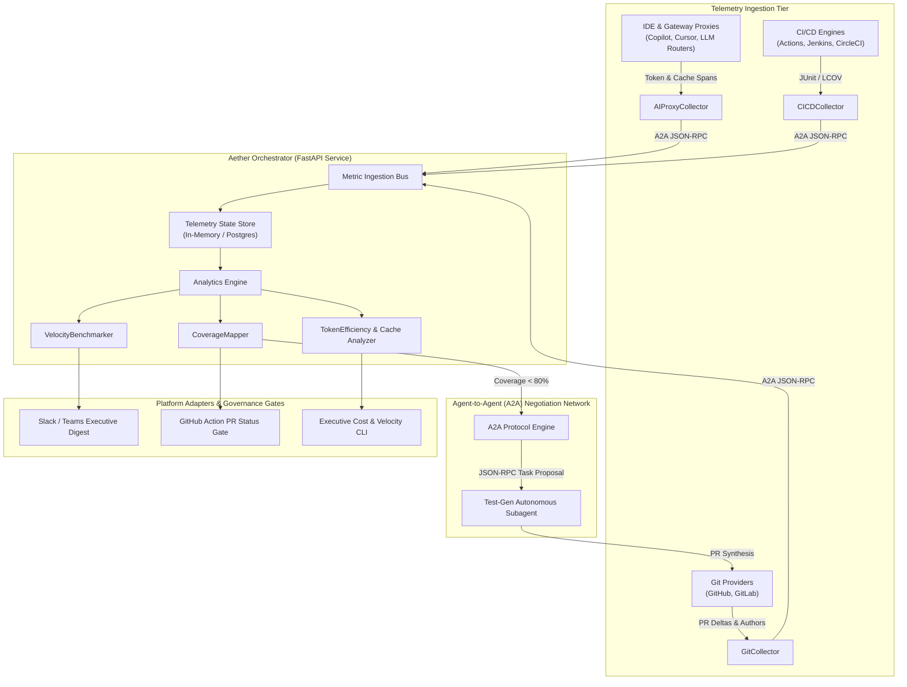
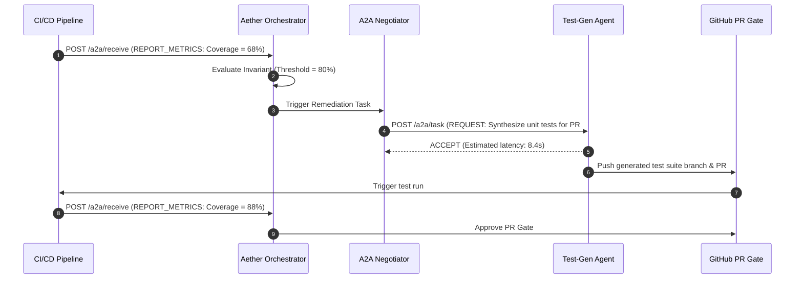

# Aether-Metrics: Engineering AI Governance & Inference Unit Economics Platform

> **Executive telemetry, DORA augmentation, LLM unit economics, and Agent-to-Agent (A2A) orchestration to measure, audit, and optimize enterprise AI adoption.**

[](https://www.python.org/)
[](https://fastapi.tiangolo.com/)
[](#agent-to-agent-a2a-autonomous-protocol)
[](#engineering-and-inference-kpi-taxonomy)
[](LICENSE)

---

## Executive Summary & Leadership Thesis

As engineering organizations deploy generative coding assistants (Copilot, Cursor, Claude Code) and operate production agentic workflows, engineering leaders face two acute governance challenges: **distinguishing genuine velocity acceleration from downstream review bottlenecks**, and **controlling production AI inference unit economics**.

Headline per-million-token prices and raw commit counts actively mislead leadership:
- High code generation volume frequently correlates with increased PR review latency and elevated defect escape rates.
- Uncached multi-step agent loops resend identical 20,000+ token system prompts and tool schemas on every step, inflating compute bills by up to 2.5x compared to prefix-cached execution.
- Static model routing sends routine classification and extraction tasks to frontier models ($4–$10/M input) when mid-tier models deliver equivalent task completion at one-fifth the cost.

**Aether-Metrics** provides engineering executives (VPs, Directors, Heads of AI Platform) with a vendor-neutral telemetry and autonomous governance control plane. Born from operating experience managing $40M+ infrastructure budgets and ~1B monthly voice AI sessions, it unifies IDE telemetry, CI/CD pipelines, and model gateway logs into actionable **DORA + Inference Unit Economics indicators**, paired with an **Agent-to-Agent (A2A) orchestration runtime** that triggers automated remediation when coverage or cost invariants drift.

---

## Engineering and Inference KPI Taxonomy

Aether-Metrics operationalizes six core metric domains across developer productivity and runtime inference economics:

| KPI Category | Operational Metric | Mathematical Formulation | Leadership Action Trigger |
| :--- | :--- | :--- | :--- |
| **Cost per Completed Task** | End-to-End Agent Loop Spend | $C_{\text{task}} = \sum_{i=1}^{N} \left( T_{\text{write},i} P_{w} + T_{\text{read},i} P_{r} + T_{\text{new},i} P_{\text{in}} + T_{\text{out},i} P_{\text{out}} \right)$ | Re-architect prompt layout or adjust tier routing when $C_{\text{task}}$ breaches budget SLO. |
| **Prefix Cache Hit Ratio** | Cached vs. Total Input Tokens | $\text{CHR} = \frac{\sum T_{\text{cached\_read}}}{\sum \left( T_{\text{cached\_read}} + T_{\text{uncached\_in}} + T_{\text{cache\_write}} \right)}$ | Flags non-deterministic system prompt ordering or multi-tenant worker cache eviction if $< 75\%$. |
| **Tier Routing Efficiency** | Mid-Tier vs. Frontier Offload | $\text{TRE} = 1 - \frac{\sum C_{\text{routed}}}{\sum C_{\text{all-frontier}}}$ | Triggers automated evaluation runs against updated model tiers to recalibrate router thresholds. |
| **Velocity Delta ($\Delta V$)** | Lead Time & Cycle Time Delta | $\Delta T_{\text{cycle}} = \frac{T_{\text{pre-AI}} - T_{\text{post-AI}}}{T_{\text{pre-AI}}} \times 100$ | Negative delta indicates PR review bottlenecks or AI-generated code friction. |
| **Token-to-Value Efficiency** | Cost-per-Story-Point Ratio | $\text{TVE} = \frac{\sum \text{Tokens}_{\text{consumed}}}{\text{Story Points Delivered}}$ | Identifies runaway token spend on non-shipping refactors or retry loops. |
| **Autonomous Coverage Gaps** | Feature-to-Test Mapping | $\text{Cov}_{\text{feat}} = \frac{\text{Tested Feature Paths}}{\text{Total Merged Feature Paths}}$ | Dispatches A2A subagents to synthesize unit tests before merge if $< 80\%$. |

---

## Reference Economics: Prefix Caching vs. Generational Price Cuts

In multi-step agent loops (e.g., a 20,000-token stable prefix of system instructions and tool definitions, 2,000 new input tokens, and 1,000 output tokens repeated across 10 steps within the cache TTL), **architectural prompt caching delivers roughly 3x the savings of a 20% vendor list-price reduction**:

| Model Tier | Input / Output (per 1M) | Cache Write / Read (per 1M) | 10-Step Task (Uncached) | 10-Step Task (Prefix Cached) | Net Task Saving |
| :--- | :--- | :--- | :--- | :--- | :--- |
| **Claude Opus 5** | \$5.00 / \$25.00 | \$6.25 / \$0.50 | \$1.350 | \$0.565 | **58.1%** |
| **Claude Opus 5.5** | \$4.00 / \$20.00 | \$5.00 / \$0.20 | \$1.080 | \$0.416 | **61.5%** |
| **GPT-6.1 Sol** | \$2.00 / \$10.00 | \$2.50 / \$0.10 | \$0.540 | \$0.208 | **61.5%** |

*Operational Constraint:* Because cache writes carry a 25% surcharge over base input (e.g., \$5.00 vs. \$4.00 on Opus 5.5) and entries expire after 5 minutes of inactivity by default, Aether-Metrics tracks **effective reuse depth** per prefix hash to ensure workloads cross the 2-step break-even threshold.

---

## Platform Architecture



---

## Agent-to-Agent (A2A) Autonomous Protocol

Unlike passive engineering dashboards, Aether-Metrics operates as an **active closed-loop control plane**. When `CoverageMapper` detects a deficit between newly merged feature code and unit test coverage, it negotiates directly with specialized subagents over JSON-RPC:



### A2A Message Schema

All inter-agent communication enforces strict Pydantic contract definitions:

```json
{
  "sender_id": "Collector-Agent-CI-01",
  "recipient_id": "Aether-Orchestrator",
  "request_type": "REPORT_METRICS",
  "payload": {
    "coverage": {
      "repository": "billing-service",
      "microservice": "payment-router",
      "feature_name": "idempotent-stripe-webhook",
      "test_case_count": 14,
      "line_coverage_pct": 74.2,
      "uncovered_lines": [48, 52, 98, 104]
    },
    "inference_economics": {
      "model_tier": "claude-opus-5.5",
      "prefix_cache_hit_ratio": 0.84,
      "cost_per_completed_task_usd": 0.416
    }
  },
  "timestamp": "2026-10-15T03:00:00Z"
}
```

### Automated Executive Weekly Digest (Slack / Teams Preview)

```text
-----------------------------------------------------------------
AETHER-METRICS EXECUTIVE DIGEST | Week 42 (Oct 2026)
-----------------------------------------------------------------
Velocity Delta (Cycle Time):    -24.8% (Improved from 4.2d to 3.1d)
Cost per Completed Agent Task:  $0.38 avg (-42% via prefix caching)
Prefix Cache Hit Ratio (SLO):   86.4% across production agent loops
Token-to-Value Efficiency:      $4.12 per merged story point (-18% MoM)
Feature Coverage Invariant:     94.2% across 18 microservices
A2A Autonomous Remediations:    12 coverage gaps auto-resolved
-----------------------------------------------------------------
Cost Anomaly Flagged: Service 'inventory-sync' cache hit ratio dropped
to 19% due to dynamic timestamp injection in system prompt prefix.
-----------------------------------------------------------------
```

---

## Repository Topology

```text
leadership/
├── README.md                      # Executive Platform Specification
└── aether_metrics/
    ├── main.py                    # Service runtime & background collection loop
    ├── requirements.txt           # Production dependencies
    ├── agents/
    │   ├── orchestrator.py        # FastAPI A2A hub and endpoint handlers
    │   └── models.py              # Pydantic schemas (A2AMessage, Metrics)
    ├── collectors/
    │   └── base_collector.py      # Abstract telemetry scrapers (AI usage, Coverage)
    ├── analyzers/                 # Velocity, coverage, and token efficiency engines
    ├── config/                    # Organization and team policy configurations
    └── platform_adapters/         # Slack, GitHub Actions, and CLI output formatters
```

---

## Quickstart & Validation

### 1. Environment Initialization

```bash
cd leadership
python3 -m venv .venv && source .venv/bin/activate
pip install -r aether_metrics/requirements.txt
```

### 2. Launch Orchestrator & Run Verification Cycle

The primary entry point initializes the FastAPI A2A listener on port `8000` and runs an asynchronous collection cycle:

```bash
python3 -m aether_metrics.main
```

Expected output:
```text
INFO:     Started server process [84210]
INFO:     Waiting for application startup.
INFO:     Application startup complete.
INFO:     Uvicorn running on http://0.0.0.0:8000

--- Starting Mock Collection Cycle ---

Received message from Collector-Agent: REPORT_METRICS
Received message from Collector-Agent: REPORT_METRICS
Collection cycle successfully completed. Metrics persisted to telemetry bus.
```

### 3. Query Real-Time Telemetry

```bash
curl -X GET http://localhost:8000/metrics/summary \
  -H "Content-Type: application/json"
```

---

## Security, Privacy & Data Custody

1. **Zero Raw Code Exfiltration:** Collectors scrape metadata, AST hashes, line coverage statistics, prefix cache hit ratios, and token usage deltas. Application source code is never ingested into the telemetry bus.
2. **Deterministic Role-Based Auditability:** Every A2A negotiation and task dispatch is logged with caller identity, timestamps, and target repositories.
3. **Multi-Tenant Policy Isolation:** Team metrics, routing thresholds, and token budgets are isolated per business unit.

---

## License & Attribution

Distributed under the **MIT License**. Maintained by **Hooman Parta** ([@hoomanp](https://github.com/hoomanp)).
